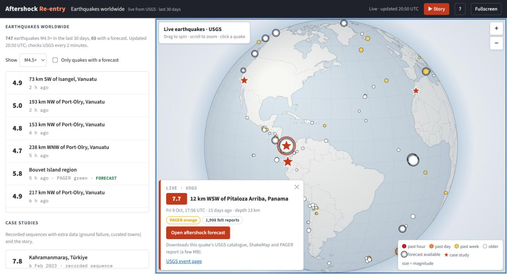
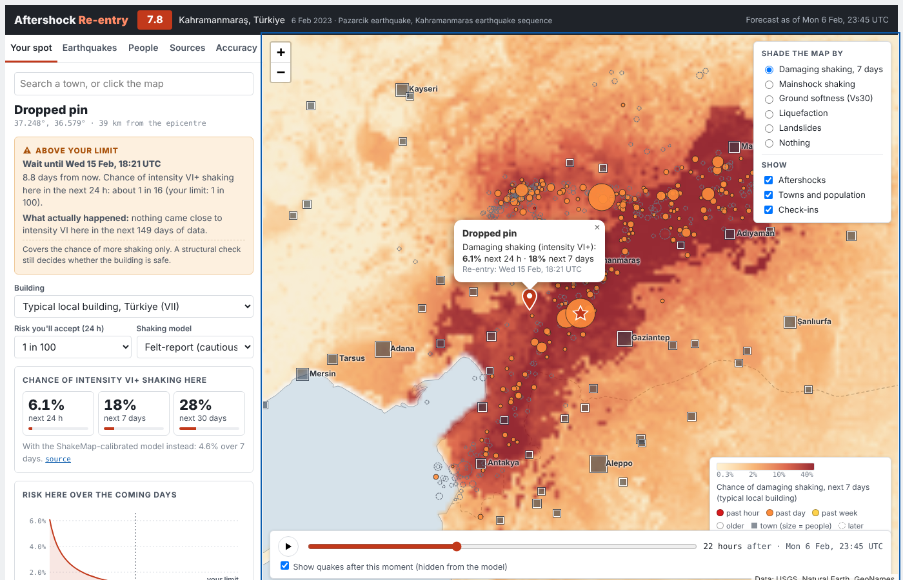

# Aftershock Re-entry

**After a big earthquake, how does the estimated risk of further shaking change?**

Aftershock Re-entry estimates the chance of shaking above a chosen intensity at a location over an exposure you choose, plus the next 24 hours, 7 days and 30 days. It projects when the chance during your chosen exposure falls below a limit. It uses bundled USGS data for 13 earthquakes and a simplified Reasenberg-Jones model. It is a retrospective prototype; building inspection and local authorities determine whether entry is safe.

Built at OxHack 2026 (themes: time; data for prediction and decision making).





## Try it

Open `index.html` in a browser. It's one self-contained file (about 10 MB, with the data, map libraries and world outlines inside). The 13 case studies work offline; the live world view needs internet to reach USGS. The fonts also need internet, and fall back to system fonts without it.

- **▶ Story** (top right) runs a 7-step guided demo of the Türkiye 2023 sequence. Use **→ / ←** or a presentation clicker to move between steps, and **Esc** to exit.
- The page opens on the **live globe**: drag to spin, scroll to zoom, click a quake, then **Open aftershock forecast**. **◀ World map** in the header comes back to it.
- **?** reopens the welcome screen. **Space** plays the timeline. **Fullscreen** is for presenting.
- [`PITCH.md`](PITCH.md) has a timed 5-minute script that follows the story and ends on the live globe, plus answers to likely questions.

To host it, push this repo to GitHub, go to **Settings → Pages**, choose **Deploy from a branch**, pick `main` and `/ (root)`, and the app will be served at `https://<your-username>.github.io/aftershock-reentry/`.

## What it does

- **Live world view.** The page opens on a globe of every M4.5+ earthquake in the last 30 days, from the USGS feed and checked every 2 minutes. Drag to spin, scroll to zoom, click a quake. Any quake with a USGS ShakeMap opens the same forecast, built in the browser from its live catalogue, ShakeMap and PAGER report; while it's open, the catalogue is re-checked every 2 minutes. The 13 case studies are the red stars.
- **Story mode.** A guided 2-minute demo of the Türkiye 2023 sequence, built for pitching.
- **Map-first console.** Click anywhere, or search a town, to set your spot. Play the timeline to watch the sequence unfold. Aftershocks are coloured by age, as on USGS maps.
- **Exposure duration.** Choose 5, 10 or 30 minutes, 1 hour, 8 hours or 24 hours. The probability, parameter range, projected start and curve use that entire interval. The 24-hour, 7-day and 30-day context figures remain available.
- **Compare two places.** Keep your spot A and choose B on the map or by town search. Compare shaking over the selected duration, ground softness, mainshock intensity, modelled ground-failure extent and coast proximity. Both places use the same intensity threshold; neither is a verified shelter.
- **Since your saved check.** Save a check, then move the replay timeline, change assumptions or return after a data update. The explanation distinguishes elapsed time, newly visible events, revised past entries, location/settings changes and data/model updates. Checks remain in this browser, with a session-only fallback if storage is blocked. This is not a live news or alert feed.
- **Forecast at your spot.** Modelled intensity exceedance from M5+ aftershocks, a projected threshold-crossing time, and a curve of how the estimate changes. A 90% parameter range describes fitted rate uncertainty, excluding other model errors.
- **200 simulated futures.** Monte Carlo runs from the same posterior and marked Poisson process as the displayed formula. This model does not simulate secondary triggering (ETAS).
- **Danger factors.** Distance to aftershock activity, ground softness (Vs30), how hard your spot already shook, liquefaction and landslide models, a country fatality proxy (USGS PAGER; not building fragility), and distance to the coast (tsunami).
- **People.** Population near you, people at risk this week, and the official count of people who felt each shaking level.
- **Opt-in safety check-ins.** Mark yourself safe or in need of help. This needs a shared database (see [Limitations](#limitations)).
- **Sources and accuracy tabs.** Source links, processing dates and model assumptions, with regional occurrence checks where complete outcome windows exist.

## How the forecast works

| Step | Method | Source |
|---|---|---|
| How many aftershocks | Reasenberg–Jones (1989) model, updated by Bayes' rule with the sequence's own M5+ aftershocks | Prototype prior from the same model family; USGS operational forecasts use tectonic-region-specific parameters |
| Where | Future aftershocks cluster around past ones (6 km smoothing, 10 km depth) | USGS ComCat catalogue |
| How hard at your spot | Allen, Wald & Worden (2012) intensity equation, including its scatter | As implemented in OpenQuake |
| Your ground | Soil term `ΔMMI = -1.76 × log10(Vs30/760)`, fitted by us to 86,234 ShakeMap cells (90% range -1.99 to -1.25) | USGS ShakeMap Vs30 grids |
| Your building | Modified Mercalli damage levels, or for "typical local building", the intensity where the country's fatality rate reaches 1 in 10,000 | USGS PAGER empirical fatality model |
| Already weakened | Threshold drops one level if the spot shook near that level in the mainshock, or if 10% or more of the ground is expected to have liquefied | USGS ShakeMap and ground-failure products |

The rules marked "our rule" in the app (the PAGER-based threshold, the 10% liquefaction cut-off, the one-level drop) are our design choices, not published standards.

## How accurate is it?

On the bundled catalogue, 93 complete seven-day forecast windows can be scored across 12 of the 13 sequences. The newest sequence has insufficient follow-up. These checks concern regional occurrence, not point shaking or building damage.

| Target | Model Brier score | Other-sequence reference Brier | Skill |
|---|---:|---:|---:|
| M5+ in the next 7 days | 0.121 | 0.270 | 0.55 |
| M6+ in the next 7 days | 0.140 | 0.138 | -0.01 |

Lower Brier is better; negative skill means worse than the reference. For each forecast, the reference frequency excludes its entire earthquake sequence. This is a retrospective comparison, not a chronological holdout; overlapping windows are correlated. The old pooled baseline gives skills 0.51 and -0.09 but uses the evaluated outcomes to estimate the reference frequency.

The 26 aftershock ShakeMap comparisons are in-sample diagnostics, not independent calibration. The optional -0.90 intensity offset is an event-average gap; it is not evidence that the unadjusted equation is always conservative. The soil term was fitted to mainshock grids using a different distance formulation and then transferred to the aftershock equation.

See [the model audit](docs/model-audit.md) for numerical fixes, evidence, sources and remaining scientific limits. The CLI and the Accuracy tab share the validation implementation.

```bash
npm test
npm run backtest
npm run backtest -- --json   # write data/validation-report.json
npm run audit:data          # read-only comparison with current USGS records
npm run build
npm run check
```

## Repo layout

```
index.html                 built app, ready to open or host (works offline)
PITCH.md                   5-minute pitch script and Q&A
src/template.html          app UI and logic (placeholders filled by the build)
src/model.js               aftershock rate model (Reasenberg–Jones + Bayesian update)
src/shake.js               shaking, uncertainty ranges and consistent Monte Carlo futures
src/validation.js          regional occurrence checks shared by the UI and CLI
src/scenario.js            duration estimates and saved-check change explanations
src/planner.js             browser controls for comparison pins and local saved checks
src/globe.js               world view: canvas globe drawn with d3-geo
src/live.js                live USGS feed and per-quake loader for the browser (mirrors fetch_usgs.mjs)
tests/forecast.test.js      numerical, simulation and data-integrity regression tests
tests/scenario.test.js      exposure windows, threshold crossings and change attribution
tests/planner.test.js       controller workflows with DOM/map/storage test doubles
tests/live.test.js          live loader: grid parsing, 180° handling, coast clipping, PAGER
data/                      everything the app embeds
  sequences.json           catalogue + ShakeMap grids (MMI, Vs30) for 13 quakes
  ground-failure-and-pager.json  liquefaction/landslide grids, PAGER exposure and building notes
  basemap.json             coastlines, borders, town names per area
  population.json          town populations, PAGER country fatality curves (all countries)
  world-towns.json         towns of 5,000+ people worldwide, for live earthquakes
  aftershock-shakemap-check.json  equation vs ShakeMap gaps for 26 aftershocks
  site-term-fit.json       fitted soil coefficient
scripts/
  fetch_usgs.mjs           download catalogue, ShakeMaps, ground failure and PAGER from USGS
  fit_site_term.py         fit the soil term to the ShakeMaps
  prep_basemap.js          clip Natural Earth + GeoNames to each area
  prep_population.js       town populations + PAGER curves + world towns
  build.py                 assemble index.html (inlines the fitted soil term into src/shake.js)
  python.mjs               run Python as python3, python or py, whichever the machine has
  backtest.js              score the aftershock model
docs/screenshot.png        case-study map view
docs/globe.jpg             live world view
```

## Rebuild from scratch

Needs Node 20+ and Python 3 with numpy. Works on Windows, macOS and Linux: the npm scripts find Python whether it's installed as `python3`, `python` or `py`.

```bash
npm install
pip install -r requirements.txt
npm run fetch      # downloads from USGS, takes a few minutes
npm run fit        # soil term
npm run prep       # base map + population
npm run build      # writes index.html
```

To rebuild only the page after editing `src/`, run `npm install` and then `npm run build`.

`scripts/fetch_usgs.mjs` is a Node port of the browser code that produced the shipped data. Every other script was checked to reproduce the files in `data/` exactly. To add an earthquake, append its USGS event ID to `MAINS` in `fetch_usgs.mjs` and its country to `SEQC` in `prep_population.js`.

## Limitations

- **Prototype, not safety advice.** Whether a building is safe to enter is decided by a structural inspection and local authorities. This tool only covers the chance of more shaking.
- **Live quakes have less data.** Ground-failure maps (liquefaction, landslides) are not loaded for live earthquakes, the coastline is 1:50m Natural Earth, and towns are limited to 5,000+ people. A ShakeMap only exists for some quakes, usually M5.5+, and is often an automatic first version. A live forecast is not an official USGS aftershock forecast.
- **Case studies are snapshots.** Catalogue entries include later revisions, and mainshock ShakeMaps may have been processed years after the replay time. Filtering by origin time does not reconstruct the data available then.
- **Model scope.** A single prior is used globally. Shaking uses a fixed 10 km depth, an active-crust equation, an experimental soil term, M5 to below M8.5, and a 400 km source-distance cutoff. Smaller aftershocks can still cause damage.
- **Resolution** follows each ShakeMap grid: about 1 km for Türkiye and 1.8–3.7 km elsewhere. It's neighbourhood-scale, not street-by-street.
- **No global data** for nearby trees, walls, power lines or dams. The app asks the user instead, and that only changes the advice on where to wait.
- **Check-ins** use the shared database of the Claude-hosted version. A standalone copy (e.g. GitHub Pages) shows them as unavailable until it's given its own backend.
- Town populations are point counts from GeoNames, so rural homes aren't included.

## Data and credits

- Earthquake catalogue, ShakeMap, ground failure and PAGER: [U.S. Geological Survey](https://earthquake.usgs.gov) (public domain).
- PAGER fatality model: [usgs/pager](https://github.com/usgs/pager), after Jaiswal & Wald.
- Intensity equation: Allen, Wald & Worden (2012), via [OpenQuake](https://github.com/gem/oq-engine).
- Coastlines and borders: [Natural Earth](https://www.naturalearthdata.com) via `world-atlas` (public domain).
- Places and populations: [GeoNames](https://www.geonames.org) via `cities.json` and `all-the-cities` (CC BY 4.0).
- Map library: [Leaflet](https://leafletjs.com) (BSD-2-Clause); globe: [d3-geo](https://d3js.org/d3-geo) (ISC) and [topojson-client](https://github.com/topojson/topojson-client) (ISC). All bundled into `index.html` by the build.
