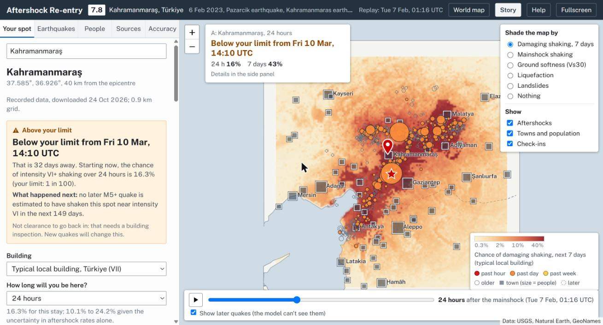

# AfterQuake

**After a big earthquake, how does the estimated risk of further shaking change?**

AfterQuake helps people understand further shaking at their chosen place, hear a short summary and check in with a group. The main screen shows one estimate and practical steps; charts and model details are optional. It uses public USGS data and a simplified aftershock model. It cannot inspect a building or give permission to re-enter.

Built at OxHack 2026 (themes: time; data for prediction and decision making).




## Try it

**Try AfterQuake:** https://afterquake-one.vercel.app

The app is deployed on Vercel. To run the project locally or configure shared check-ins, see the setup instructions in [`docs/checkins.md`](docs/checkins.md).

## What it does

- **Live world view.** Opens on a globe of every M4.5+ earthquake in the last 30 days, from the USGS feed, refreshed every 2 minutes. Drag to spin, scroll to zoom, or click a quake. Any quake with a USGS ShakeMap opens the same forecast, built in the browser from its live catalogue, ShakeMap and PAGER report. All three are checked every 2 minutes while open; revised products replace earlier versions without resetting pins or selected time. **Refresh USGS** checks immediately; **Go to live time** resumes following the latest data. Failed or delayed updates are labelled, with the last successful data retained. The 13 case studies are marked with red stars.

- **Story mode.** Follow the Türkiye 2023 narrative, from the first shaking to checking in and opening a recent earthquake. A compact panel keeps Back, Next and Exit visible. Optional story controls demonstrate time, Gemini answers, ElevenLabs speech and Tiger Data records.

- **Live now and forecast check.** **Live now** jumps to the most active shallow aftershock sequence of the past week with a USGS shaking map: the sequence with the most M4.5+ quakes within 250 km, then the largest mainshock. It flies the globe to the sequence and opens its forecast. Use `?live=<USGS event id>` to pin a specific quake. For a live sequence, **Live forecast check** refits the model using only quakes recorded up to 24 hours earlier, then compares its expected M5+ aftershock count for the next day (with a 90% range) against subsequent USGS observations. If the newest quake's USGS products are incomplete, it tries the next one and reports if neither loads. The story's last step links to this check.

- **Join on your phone.** Displays a QR code and short link (`#j=<earthquake>.<group>`). Scanning opens the same earthquake on a phone, joins the check-in group and lands on the check-in buttons. While presenting, check-ins on the presenting screen refresh every 3 seconds. Without the check-in service, the code simply opens the same forecast.

- **Map-first console and exposure duration.** Click anywhere or search a town to set your spot; play the timeline to watch the sequence unfold. Aftershocks are coloured by age, as on USGS maps. Choose an exposure duration of 5, 10 or 30 minutes, 1 hour, 8 hours or 24 hours. Probability, parameter range, projected start and curve use the entire selected interval, while 24-hour, 7-day and 30-day context figures remain available.

- **Forecast summaries and voice.** Get a short readout in English, Chinese or the earthquake's local language, with stop and speed controls and a transcript. It uses one calculated estimate, labels recorded or delayed data, and gives practical next steps. Hosted speech uses ElevenLabs and Gemini, with device English speech as a fallback. The **Quick summary** includes the selected date, one estimate and timeframe, earthquake magnitude, a relevant local condition and practical next steps; it flags delayed data and omits repeated example labels, model ranges, settings and projected entry times. Optional forecast detail lets you explore the next 24 hours, 7 days and 30 days, the uncertainty range and how estimates change with time. A projected lower chance is not a re-entry time.

- **Share this place.** Share the selected place, timeframe and replay time. Older links open their main place using the standard estimate.

- **Danger factors.** Explore distance to aftershock activity, ground softness (Vs30), how hard your spot already shook, liquefaction and landslide models, a country fatality proxy (USGS PAGER; not building fragility), and distance to the coast (tsunami).

- **People.** Shows population near you, people at risk this week, and the official count of people who felt each shaking level.

- **Gemini forecast chat.** Open **Ask about this forecast** from the chat bubble in the bottom-left corner of the map. Ask about your selected place, a different stay, how risk changes over time, local risk factors or the data behind the estimate. Gemini uses the page's calculated forecast, and each answer lets you inspect what it checked. Its instructions prohibit clearing a building for entry. Requires the configured assistant API (see [the assistant](#the-assistant)).

- **Aftershock rate from Tiger Data.** Every USGS quake the app sees is stored in a Tiger Data hypertable. An hourly continuous aggregate feeds a chart comparing the observed aftershock rate with the forecast model's expected rate. See [the time series](docs/tiger.md).

- **Group check-ins and notes with Tiger Data.** Open **Check in** to create a group or join one using an invite link, code or phone QR. Choose **I'm safe here** or **I need help here**, add an optional short note at your map pin, and update or remove your own post. Your group can see shared pins, notes, safe/help counts and hourly status updates; posts expire after 24 hours. These updates do not contact emergency services. Requires the hosted API and a configured Tiger Data PostgreSQL service. See [database setup](docs/checkins.md).

- **Sources and accuracy tabs.** View source links, processing dates and model assumptions, with regional occurrence checks where complete outcome windows exist.

## How the forecast works

| Step | Method | Source |
|---|---|---|
| How many aftershocks | Reasenberg–Jones (1989) model, updated by Bayes' rule with the sequence's own M5+ aftershocks | Prototype prior from the same model family; USGS operational forecasts use tectonic-region-specific parameters |
| Where | Future aftershocks cluster around past ones (6 km smoothing, 10 km depth) | USGS ComCat catalogue |
| How hard at your spot | Allen, Wald & Worden (2012) intensity equation, including its scatter | As implemented in OpenQuake |
| Your ground | Soil term `ΔMMI = -1.76 × log10(Vs30/760)`, fitted by us to 86,234 ShakeMap cells (90% range -1.99 to -1.25) | USGS ShakeMap Vs30 grids |
| Your building | Modified Mercalli damage levels, or for "typical local building", the intensity where the country's fatality rate reaches 1 in 10,000 | USGS PAGER empirical fatality model |
| Already weakened | Threshold drops one level if the spot shook near that level in the mainshock, or if 10% or more of the ground is expected to have liquefied | USGS ShakeMap and ground-failure products |

The rules marked "our rule" in the app (the PAGER-based threshold, the 10% liquefaction cut-off, the one-level drop) are our design choices, not published standards.

## How accurate is it?

On the bundled catalogue, 93 complete seven-day forecast windows can be scored across 12 of the 13 sequences. The newest sequence has insufficient follow-up. These checks concern regional occurrence, not point shaking or building damage.

| Target | Model Brier score | Other-sequence reference Brier | Skill |
|---|---:|---:|---:|
| M5+ in the next 7 days | 0.121 | 0.270 | 0.55 |
| M6+ in the next 7 days | 0.140 | 0.138 | -0.01 |

Lower Brier is better; negative skill means worse than the reference. For each forecast, the reference frequency excludes its entire earthquake sequence. This is a retrospective comparison, not a chronological holdout; overlapping windows are correlated. The old pooled baseline gives skills 0.51 and -0.09 but uses the evaluated outcomes to estimate the reference frequency.

The 26 aftershock ShakeMap comparisons are in-sample diagnostics, not independent calibration. The historical -0.90 intensity offset (no longer offered in the interface) is an event-average gap; it is not evidence that the unadjusted equation is always conservative. The soil term was fitted to mainshock grids using a different distance formulation and then transferred to the aftershock equation.

See [the model audit](docs/model-audit.md) for numerical fixes, evidence, sources and remaining scientific limits. The CLI and the optional checks under About share the validation implementation.

```bash
npm test
npm run backtest
npm run backtest -- --json   # write data/validation-report.json
npm run audit:data          # read-only comparison with current USGS records
npm run build
npm run check
```

## General repo layout

```text
index.html                  Built app, ready to open or host (works offline)
src/
  template.html             App UI and logic, filled in by the build
  model.js                  Reasenberg–Jones aftershock model + Bayesian update
  shake.js                  Shaking estimates, uncertainty and Monte Carlo futures
  live.js                   Live USGS feed and per-earthquake data loading
  globe.js                  Interactive world globe, rendered with d3-geo
  assistant.js              Forecast tools exposed to Gemini on the page
  spoken.js                 Deterministic summaries from calculated figures
  checkins.js               Group invites, shared pins and status updates
api/
  chat.js                   Gemini assistant endpoint
  speak.js                  ElevenLabs voice and Gemini translation
  checkins.js                Shared check-in API
server/
  checkins-store.js         PostgreSQL access, transactions and TLS
db/
  checkins.sql              Check-in entries and TimescaleDB status history
data/                        Embedded earthquake, ShakeMap, population and map data
scripts/
  fetch_usgs.mjs            Download USGS earthquake and shaking data
  fit_site_term.py          Fit the soil correction to ShakeMap data
  build.py                  Assemble the standalone index.html
  backtest.js               Evaluate forecast performance
tests/                       Automated model, API, live-data and UI regression tests
docs/
  checkins.md                Shared check-in setup and deployment
  tiger.md                   Tiger Data time-series architecture
  DESIGN.md                  Design direction and implementation principles
  globe.jpg                  Live world view screenshot
  map.jpg                    Case-study map screenshot
```


## The assistant

`api/chat.js` runs on Vercel and calls the Gemini API (`generateContent` with function calling). The default model is `gemini-3.1-flash-lite` with minimal thinking. Set `GEMINI_MODEL` or `GEMINI_THINKING` to change them. Every new question must start with a tool call, so figures can't be reused or invented. Gemini replies with tool calls, the browser runs them against the open forecast (`src/assistant.js`), and the results go back to Gemini, so every figure comes from the model on the page. The function only accepts this app's message shapes and tool names, and allows about 40 requests per visitor per 10 minutes.

It needs a Gemini API key (free from [Google AI Studio](https://aistudio.google.com/apikey)) stored as a Vercel environment variable, never in the code:

```bash
npx vercel@65.2.0 env add GEMINI_API_KEY production   # paste the key when asked
npx vercel@65.2.0 deploy --prod                       # redeploy so the function sees it
```

Opened from a file or a static Python server, the assistant and shared check-ins are unavailable because their API routes are absent. Use `npm run dev` to run those routes locally with the corresponding environment settings; the recorded forecasts still work offline without them.

## Voice (ElevenLabs)

**Read summary** speaks the forecast with an [ElevenLabs](https://elevenlabs.io) voice when the hosted `api/speak.js` route is configured, in English or the earthquake's local language (for example Turkish for Türkiye, Japanese for Noto, Spanish for Ecuador and Panama). The words come from the page's own summary (`src/spoken.js`), so the figures are the model's. For other languages, Gemini translates the summary first, and the translation is discarded (falling back to English) unless every number in the English text appears in it. Without the route (opened as a file or on static hosting), the page uses the browser's own voices as before. The default model is `eleven_flash_v2_5` for low latency; the default voice is George (`JBFqnCBsd6RMkjVDRZzb`). Clips are cached per summary and language in the page, so replaying costs no extra credits. The route allows about 20 requests per visitor per 10 minutes.

```bash
npx vercel@65.2.0 env add ELEVENLABS_API_KEY production    # paste the key when asked
npx vercel@65.2.0 env add ELEVENLABS_VOICE_ID production   # optional: another voice from your library
npx vercel@65.2.0 deploy --prod                            # redeploy so the function sees it
```

English and **Chinese (中文)** are available for every earthquake when translation is configured, alongside its local language. Your selected language stays selected as you move between forecasts. Chinese and other translated languages need `GEMINI_API_KEY` too (already set for the assistant). For `npm run dev`, put the same variables in `.env.local`.

## Rebuild from scratch

Needs Node 20+ and Python 3 with numpy. Works on Windows, macOS and Linux: the npm scripts find Python whether it's installed as `python3`, `python` or `py`.

```bash
npm install
pip install -r requirements.txt
npm run fetch      # downloads from USGS, takes a few minutes
npm run fit        # soil term
npm run prep       # base map + population
npm run build      # writes index.html
```

To rebuild only the page after editing `src/`, run `npm install` and then `npm run build`.

The main navigation is Your area, Check in and About. Spoken summaries include the date, one estimate, earthquake magnitude and a relevant local condition; uncertainty ranges and model settings stay in optional detail. Comparison pins, saved-check history, simulation galleries and the alternative shaking-model switch have been removed. Older links still open their primary place using the standard estimate. The globe opens without fitting a case study or running the accuracy backtest. Charts are drawn as they come into view, and risk trends, population context and model checks sit in optional details. Map overviews are capped at 128 pixels per edge, with cached masks and images; globe drawing uses simplified outlines and a two-million-pixel budget. Place names stay visible, while population markers and future events are optional. Map shading runs in short, cancellable batches; the displayed figures still use the complete posterior. Display changes reuse the current fit, while live-data revisions clear it and the map caches. Background tabs pause polling and playback.

`scripts/fetch_usgs.mjs` is a Node port of the browser code that produced the shipped data. Every other script was checked to reproduce the files in `data/` exactly. To add an earthquake, append its USGS event ID to `MAINS` in `fetch_usgs.mjs` and its country to `SEQC` in `prep_population.js`.

## Limitations

- **Prototype, not safety advice.** Whether a building is safe to enter is decided by a structural inspection and local authorities. This tool only covers the chance of more shaking.
- **Live quakes have less data.** Ground-failure maps (liquefaction, landslides) are not loaded for live earthquakes, the coastline is 1:50m Natural Earth, and towns are limited to 5,000+ people. A ShakeMap only exists for some quakes, usually M5.5+, and is often an automatic first version. A live forecast is not an official USGS aftershock forecast.
- **Case studies are snapshots.** Catalogue entries include later revisions, and mainshock ShakeMaps may have been processed years after the replay time. Filtering by origin time does not reconstruct the data available then.
- **Model scope.** A single prior is used globally. Shaking uses a fixed 10 km depth, an active-crust equation, an experimental soil term, M5 to below M8.5, and a 400 km source-distance cutoff. Smaller aftershocks can still cause damage.
- **Resolution** follows each ShakeMap grid: about 1 km for Türkiye and 1.8–3.7 km elsewhere. It's neighbourhood-scale, not street-by-street.
- **No global data** for nearby trees, walls, power lines or dams. The app asks the user instead, and that only changes the advice on where to wait.
- **Check-ins** require a configured Tiger Data database and the API routes. A standalone file or static GitHub Pages copy cannot save shared posts. Anyone with a group invite can see its entries; these are anonymous self-reports and do not contact emergency services. See [setup and visibility](docs/checkins.md).
- Town populations are point counts from GeoNames, so rural homes aren't included.

## Data and credits

- Earthquake catalogue, ShakeMap, ground failure and PAGER: [U.S. Geological Survey](https://earthquake.usgs.gov) (public domain).
- PAGER fatality model: [usgs/pager](https://github.com/usgs/pager), after Jaiswal & Wald.
- Intensity equation: Allen, Wald & Worden (2012), via [OpenQuake](https://github.com/gem/oq-engine).
- Coastlines and borders: [Natural Earth](https://www.naturalearthdata.com) via `world-atlas` (public domain).
- Places and populations: [GeoNames](https://www.geonames.org) via `cities.json` and `all-the-cities` (CC BY 4.0).
- Font: [Public Sans](https://public-sans.digital.gov) (SIL Open Font License), from Google Fonts.
- Map library: [Leaflet](https://leafletjs.com) (BSD-2-Clause); globe: [d3-geo](https://d3js.org/d3-geo) (ISC) and [topojson-client](https://github.com/topojson/topojson-client) (ISC). All bundled into `index.html` by the build.
